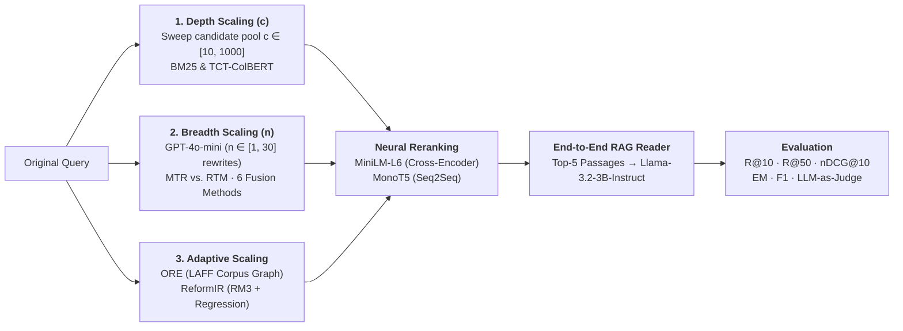
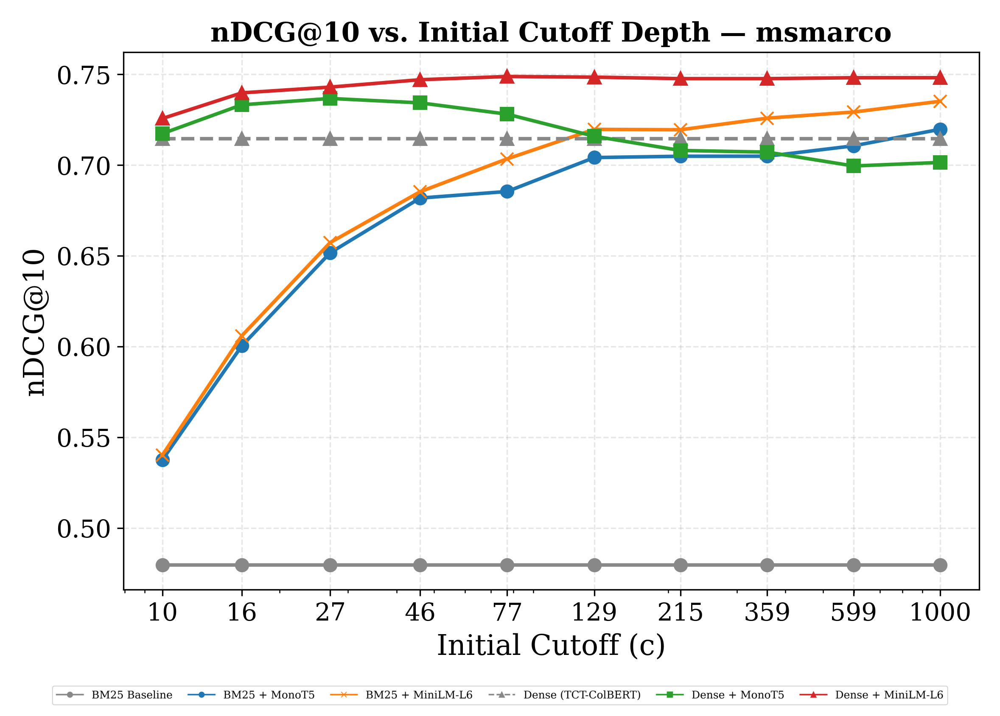
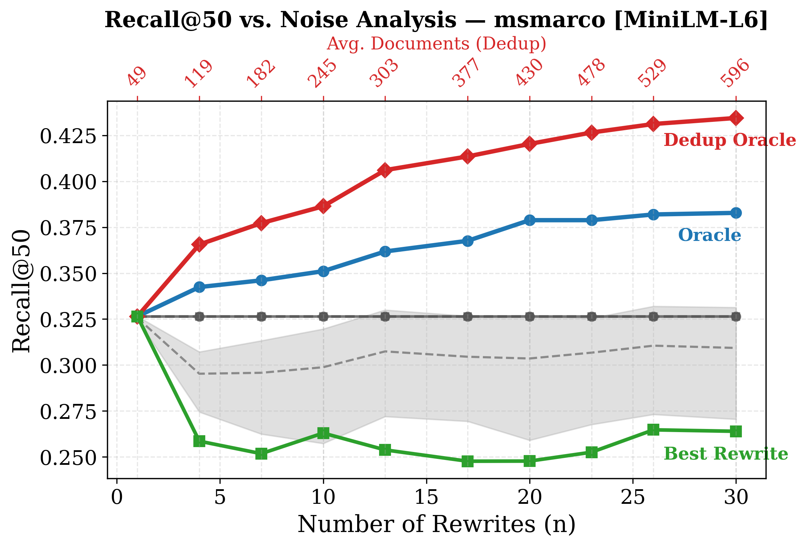
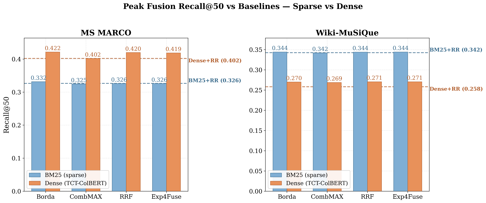
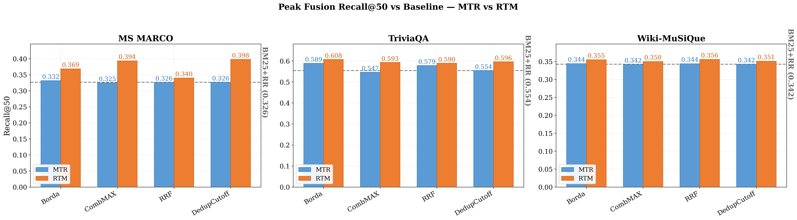
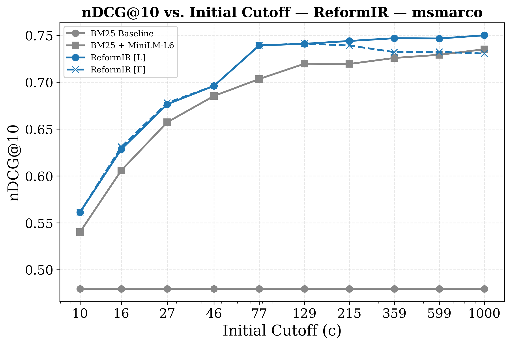

# Scaling Laws for Compound AI Systems

> **More Compute, More Problems? Rethinking Scaling Laws for Retrieval-Augmented Generation**

[](https://repository.tudelft.nl/record/uuid:f0406b81-8b50-47c9-a44b-5da89c59c916)
[](environment.yaml)
[](requirements.txt)
[](LICENSE)

> **Full Thesis:** [**Scaling Laws for Compound AI Systems — TU Delft Repository**](https://repository.tudelft.nl/record/uuid:f0406b81-8b50-47c9-a44b-5da89c59c916)
>
> **Author:** Pratham Johari · MSc Data Science & Artificial Intelligence Technology, Web Information Systems Group (EEMCS), Delft University of Technology (2025–2026)
>
> **Supervision:** Dr. Avishek Anand (Chair & Supervisor) · Dr. Mandeep Rathee (Daily Supervisor) · Dr. Julian Urbano (Core Member)

---

## Overview

As AI engineering shifts from monolithic models toward **Compound AI Systems**, test-time compute scaling in Retrieval-Augmented Generation (RAG) is frequently assumed to follow simple monotonic laws. This repository provides a reproducible, large-scale **PyTerrier** experimental framework systematically characterising inference-time compute scaling across the full `Retrieve → Fuse → Rerank → Generate` pipeline.

Across **three benchmark datasets** (MS MARCO / TREC-DL 2019, TriviaQA / DPR-w100, and 2WikiMultiHopQA), **two first-stage retrievers** (BM25 and TCT-ColBERT), **two neural rerankers** (MiniLM-L6 and MonoT5), **six rank fusion algorithms**, and **two adaptive budget-allocation baselines** (ORE and ReformIR), our findings demonstrate that **retrieval scaling is non-monotonic and conditional**—governed by system-level interactions between reranker noise tolerance, embedding space geometry, and domain calibration.

---

## Architecture & Scaling Axes



---

## Key Empirical Findings

Our experimental programme distils into **six empirical principles** for test-time compute allocation in compound retrieval systems:

| # | Empirical Principle | Quantitative Highlight |
| :-: | :--- | :--- |
| **1** | **Depth scaling succeeds or fails at the reranker** | Distilled cross-encoder **MiniLM-L6** scales monotonically across all corpora (MS MARCO nDCG@10: `0.540 → 0.735` on BM25; `0.726 → 0.748` on Dense), whereas generative **MonoT5** peaks early on Dense (`0.737` at $c=27$) and degrades to `0.701` at $c=1000$. |
| **2** | **Breadth scaling requires a continuous embedding space** | Dense **TCT-ColBERT** unlocks `+4.9–5.2%` relative R@50 gains via multi-query fusion on MS MARCO (`0.402 → 0.422/0.423`) and `+5.0%` on Wiki-MuSiQue, while sparse **BM25** stagnates within `±2%` on both (gaining `+6.3%` only on TriviaQA factoids). |
| **3** | **Pipeline ordering interacts with domain calibration** | **Rerank-then-Merge (RTM)** with score-based `DedupCutoff` boosts MS MARCO R@50 by `+22%` (`0.398` vs. `0.326` baseline) because MiniLM-L6 is in-domain; out-of-domain on TriviaQA, RTM degrades nDCG@10 by up to `-14%`, making **Merge-then-Rerank (MTR)** voting safer. |
| **4** | **Adaptive and fusion scaling are complementary** | **ReformIR** (Linear) consistently outperforms BM25+MiniLM-L6 across all cutoffs on MS MARCO (`0.750` vs. `0.735` nDCG@10) and Wiki (`0.440` vs. `0.408`); **ORE** matches full reranking when a pre-computed LAFF corpus graph exists, while fixed-budget regression degrades at large $c$. |
| **5** | **A persistent 15–17% Oracle gap exposes the fusion bottleneck** | An **Oracle** selecting the best single rewrite per query beats practical fusion by `15%` (MS MARCO), `16%` (TriviaQA), and `17%` (Wiki) in R@50, while blind LLM rewrite selection (`BestRewrite`) underperforms single-query BM25 (`0.264` vs. `0.326` on MS MARCO). |
| **6** | **Retrieval gains transfer only partially to generation** | In end-to-end **Llama-3.2-3B** RAG (top-5 context), reranking yields `+0.36` LLM-as-Judge at $c=1000$ on both TriviaQA (`6.59` vs. `6.23`) and Wiki (`5.91` vs. `5.55`), yet hurts Wiki at small depths ($c=10$: `5.14`) with high metric variance. |

---

## Selected Results

<p align="center">
  
  
</p>
<p align="center">
  <em>Left: Retrieval depth scaling on MS MARCO (Experiment 1) — MiniLM-L6 scales monotonically while Dense+MonoT5 degrades at large c.<br/>
  Right: Noise & Oracle upper-bound analysis on MS MARCO (Experiment 2 Noise) — practical fusion trails Oracle bounds by 15–17% R@50, while blind LLM selection fails.</em>
</p>

<p align="center">
  
  
</p>
<p align="center">
  <em>Left: Sparse BM25 vs. Dense TCT-ColBERT fusion (Experiments 2 & 2a) — dense retrieval amplifies multi-query fusion gains.<br/>
  Right: Merge-then-Rerank vs. Rerank-then-Merge (Experiments 2 & 2b) — in-domain RTM score fusion unlocks +22% R@50 on MS MARCO.</em>
</p>

<p align="center">
  
</p>
<p align="center">
  <em>ReformIR adaptive scaling on MS MARCO (Experiment 7) — iterative RM3 + regression in Linear [L] mode consistently beats the static BM25+MiniLM-L6 baseline, whereas Fixed [F] mode degrades once regression extrapolates beyond the budget.</em>
</p>

---

## Experimental Setup & Benchmarks

### Datasets

| Benchmark | Task | Queries Evaluated | Corpus Size | Evaluation Split |
| :--- | :--- | :---: | :---: | :--- |
| **[2WikiMultiHopQA](https://github.com/Alab-NII/2wikimultihop)** (`wiki_musique`) | Multi-hop QA | 100 *(stratified: 50% compositional, 30% comparison, 10% bridge, 10% inference)* | 495,034 | `dev` |
| **[MS MARCO Passage](https://microsoft.github.io/msmarco/)** (`msmarco-passage`) | Web Passage Retrieval | 43 *(graded judgments)* | 8.8M | `trec-dl-2019/judged` |
| **[DPR-w100 / TriviaQA](https://github.com/facebookresearch/DPR)** (`dpr-w100`) | Open-Domain Factoid QA | 100 *(deterministic prefix)* | 21M | `trivia-qa/dev` |

### Models & Fusion Methods

- **First-Stage Retrievers:** BM25 (PyTerrier / Terrier defaults) · TCT-ColBERT v2-HNP (`castorini/tct_colbert-v2-hnp-msmarco` with `FaissFlat`)
- **Second-Stage Rerankers:** MiniLM-L6 (`cross-encoder/ms-marco-MiniLM-L6-v2`) · MonoT5 (`castorini/monot5-base-msmarco`) · Qwen3-Reranker-4B support ([`code_base/qwen_reranker.py`](code_base/qwen_reranker.py))
- **Query Rewriter:** `gpt-4o-mini` ($\tau = 0.7$, 30 pre-generated nested rewrites per query)
- **Fusion Algorithms ([`code_base/transformers.py`](code_base/transformers.py)):** `DedupCutoff`, `Borda`, `BordaWeighted`, `CombMAX`, `RRF` (Reciprocal Rank Fusion), and `Exp4Fuse`
- **Adaptive Baselines:** ORE ([`code_base/ore_adaptive.py`](code_base/ore_adaptive.py)) · ReformIR ([`code_base/reformir.py`](code_base/reformir.py))
- **RAG Generator & Evaluator:** `meta-llama/Llama-3.2-3B-Instruct` (top-5 context window, EM, F1, [`code_base/llm_judge.py`](code_base/llm_judge.py), [`code_base/trivia_judge.py`](code_base/trivia_judge.py))

### Experiments Matrix

| Script | Axis / Study | Independent Variable | Guide |
| :--- | :--- | :--- | :--- |
| [`experiments/experiment_1.py`](experiments/experiment_1.py) | Depth Scaling (BM25 & Dense ± MiniLM-L6 / MonoT5) | $c \in [10, 1000]$ (log-spaced) | [Guide](experiments/mds/EXPERIMENT_1_GUIDE.md) |
| [`experiments/experiment_2.py`](experiments/experiment_2.py) | Sparse Breadth Scaling (BM25 + MTR Fusion) | $n \in [1, 30]$ rewrites ($c=50$) | [Guide](experiments/mds/EXPERIMENT_2_GUIDE.md) |
| [`experiments/experiment_2a.py`](experiments/experiment_2a.py) | Dense Breadth Scaling (TCT-ColBERT + MTR Fusion) | $n \in [1, 30]$ rewrites ($c=50$) | — |
| [`experiments/experiment_2b.py`](experiments/experiment_2b.py) | Rerank-then-Merge (BM25 + Per-Rewrite Rerank + Fusion) | $n \in [1, 30]$ rewrites ($c=50$) | — |
| [`experiments/experiment_2_noise_analysis.py`](experiments/experiment_2_noise_analysis.py) | Oracle, Dedup Oracle & Blind `BestRewrite` Bounds | $n \in [1, 30]$ rewrites | [Guide](experiments/mds/EXPERIMENT_2_NOISE_ANALYSIS_GUIDE.md) |
| [`experiments/experiment_3.py`](experiments/experiment_3.py) | Fixed-$n$ ($n=10$) Cutoff Sweep (MTR vs. RTM) | $c \in [10, 100]$ | — |
| [`experiments/experiment_4.py`](experiments/experiment_4.py) | ORE Adaptive Retrieval (Linear vs. Fixed Budget) | $c \in [10, 1000]$ | [Params](experiments/mds/ORE_PARAMS.md) |
| [`experiments/experiment_5.py`](experiments/experiment_5.py) | End-to-End RAG Pipeline (EM, F1, LLM-as-Judge) | $c \in [10, 1000]$ (top-5 reader) | [Guide](experiments/mds/EXPERIMENT_5_GUIDE.md) |
| [`experiments/experiment_7.py`](experiments/experiment_7.py) | ReformIR Adaptive Retrieval (Linear vs. Fixed Budget) | $c \in [10, 1000]$ | [Params](experiments/mds/REFORMIR_PARAMS.md) |

> Multi-node HPC (MPI / SLURM) variants used on TU Delft's **DelftBlue** cluster live in [`experiments/multi_node_versions/`](experiments/multi_node_versions/).

---

## Repository Structure

```text
.
├── assets/figures/                  # Showcase result plots featured in this README
├── code_base/                       # Core PyTerrier transformers, datasets, judges & runners
│   ├── cross_encoder_reranker.py    # MiniLM-L6 cross-encoder PyTerrier transformer
│   ├── dataset_factory.py           # Unified dataset loader (Wiki-MuSiQue, MS MARCO, DPR-w100)
│   ├── experiment_runner.py         # Unified sweep, logging, and artifact-saving harness
│   ├── experiment_utils.py          # Plotting, metadata capture, and text-getter utilities
│   ├── llm_best_rewrite.py          # Blind LLM rewrite selector (BestRewrite baseline)
│   ├── llm_judge.py                 # Local Llama-3.2-3B LLM-as-Judge evaluator
│   ├── llm_q.py                     # OpenAI GPT-4o-mini query rewrite generator & cache
│   ├── ore_adaptive.py              # ORE graph-based adaptive retrieval transformer
│   ├── qwen_reranker.py             # Qwen3-Reranker-4B vLLM transformer
│   ├── reformir.py                  # ReformIR iterative RM3 + regression transformer
│   ├── transformers.py              # Custom fusion (Borda, CombMAX, RRF, Exp4Fuse) & dedup ops
│   ├── trivia_judge.py              # Multi-answer TriviaQA LLM-as-Judge measure
│   └── wiki_loader_pyt.py           # 2WikiMultiHopQA corpus & qrels loader
├── experiments/                     # Experiment scripts, guides, tests & MPI cluster runners
│   ├── mds/                         # Detailed methodology & hyperparameter notes
│   ├── multi_node_versions/         # MPI + SLURM scripts for multi-node HPC execution
│   └── experiment_*.py              # Standalone experiment runners (Exp 1 – Exp 7)
├── results/                         # Final per-dataset CSVs, metadata JSONs, and plots
├── scripts/                         # Model downloads, PyTerrier/Faiss indexing & ORE setup
├── constants.py                     # Central portable configuration (env-var overridable)
├── generate_thesis_plots.py         # Publication-quality plot generator from saved CSVs
├── generate_latex_tables.py         # LaTeX results table exporter
├── compare_exp2_vs_exp2b.py         # MTR vs. RTM comparative plotting utility
├── environment.yaml                 # Conda environment specification
└── requirements.txt                 # Pip dependencies
```

---

## Quick Start & Reproducibility

### 1. Environment Setup

```bash
git clone https://github.com/pratham2442000/MasterThesis.git
cd MasterThesis

# Option A: Conda environment (recommended)
conda env create -f environment.yaml
conda activate mt

# Option B: Pip installation (Python 3.11+, Java 11+ required for PyTerrier)
pip install -r requirements.txt
```

### 2. Configuration

[`constants.py`](constants.py) resolves data and result paths relative to the repository root by default, and supports environment-variable overrides for clusters or custom storage:

```bash
export DATASET_NAME="msmarco-passage"        # "wiki_musique" | "msmarco-passage" | "dpr-w100"
export RERANKER_TYPE="cross_encoder"         # "cross_encoder" (MiniLM-L6) | "monot5"
export THESIS_DATA_DIR="./data"              # Optional custom dataset root
export THESIS_RESULTS_DIR="./results"        # Optional custom results root
export OPENAI_API_KEY="sk-..."               # Required only when regenerating query rewrites
```

### 3. Prepare Models, Indices, and Rewrites

See [`scripts/README.md`](scripts/README.md) for detailed flags:

```bash
python scripts/download_models.py            # Cache HuggingFace models locally
python scripts/dataset_setup.py              # Build BM25, dense TCT-ColBERT indices & rewrites
python scripts/build_all_ore.py              # Build TasB FlexIndex & LAFF corpus graphs (for Exp 4)
```

### 4. Run Experiments & Regenerate Plots

```bash
# Run an experiment (outputs CSVs, metadata JSON, and plots under results/<dataset>/)
python experiments/experiment_1.py
python experiments/experiment_2.py

# Regenerate publication-quality thesis plots directly from saved CSVs (no GPU needed)
python generate_thesis_plots.py
```

---

## Citation

If you find this codebase or our empirical findings useful, please cite the thesis:

```bibtex
@mastersthesis{johari2026scaling,
  author  = {Johari, Pratham},
  title   = {Scaling Laws for Compound AI Systems: More Compute, More Problems? Rethinking Scaling Laws for Retrieval-Augmented Generation},
  school  = {Delft University of Technology},
  year    = {2026},
  month   = {June},
  url     = {https://repository.tudelft.nl/record/uuid:f0406b81-8b50-47c9-a44b-5da89c59c916}
}
```

---

## License

This project is released under the [MIT License](LICENSE).
